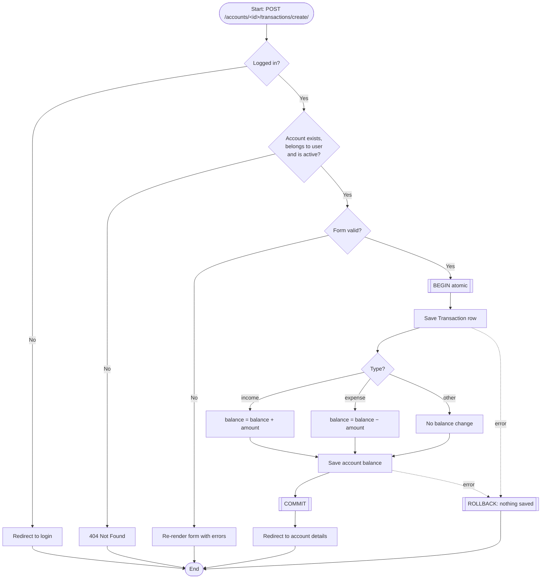
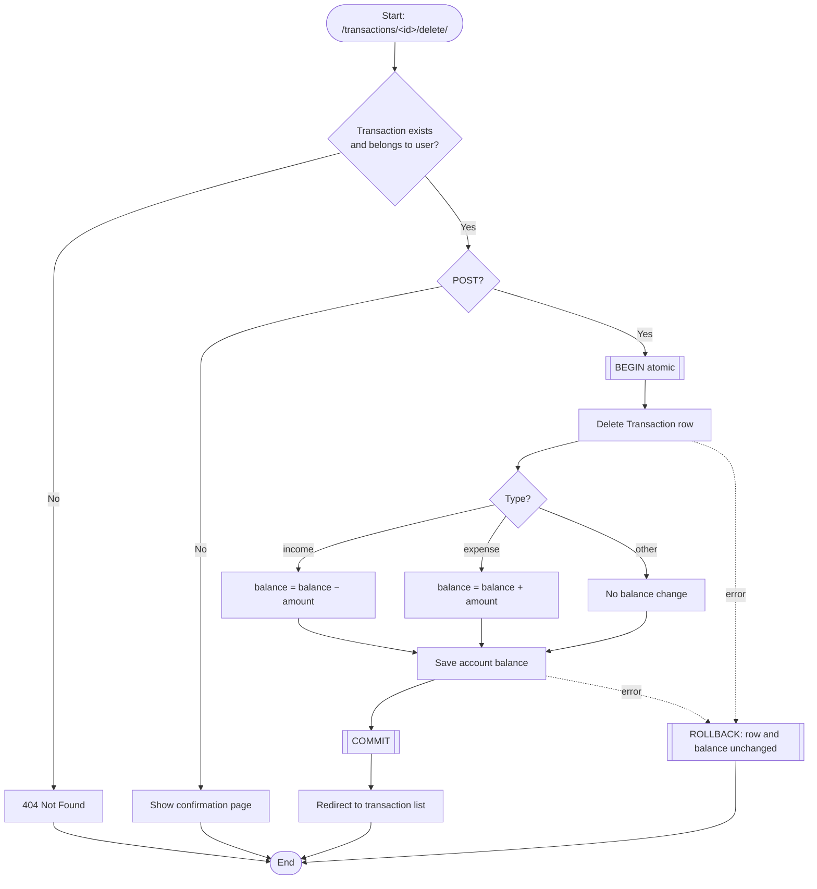

# Algorithm: balance update on create / delete

Based on `accounts/views.py` → `create_transaction` and `transactions/views.py` →
`delete_transaction`. Both run inside `transaction.atomic`: either the transaction row
**and** the balance change are saved, or neither is.

## Create transaction

## Delete transaction (undo its effect)

Delete is the exact inverse of create, so create followed by delete leaves the balance
where it started. That's a property worth testing and mentioning in the coursework.
