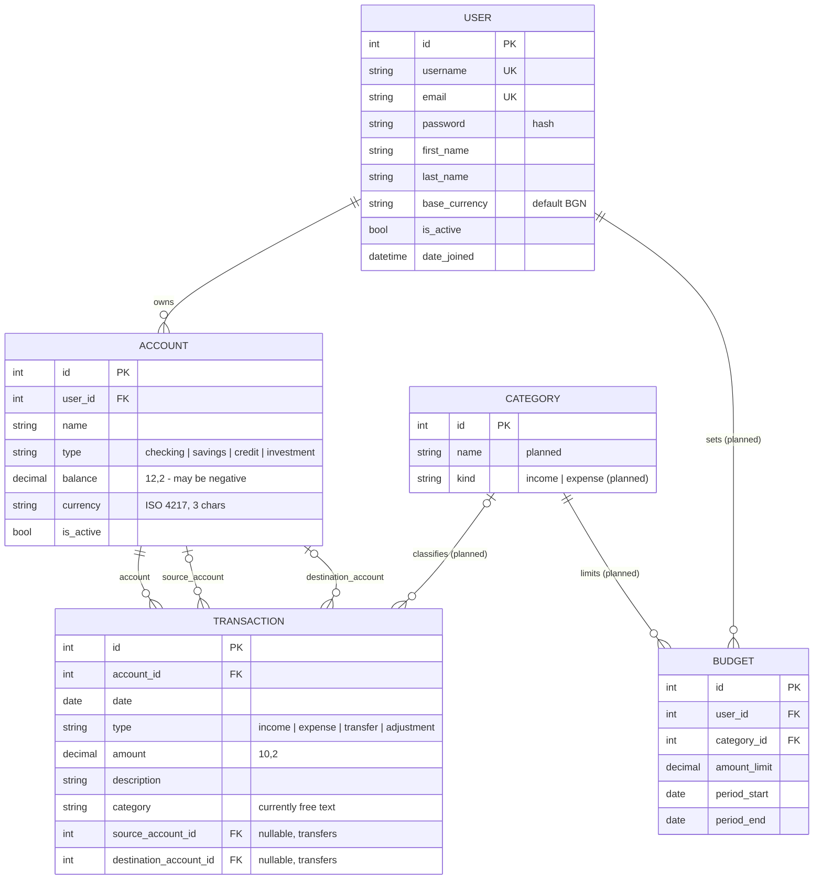

# Entity-relationship diagram

Source: hand-drawn "Data modeling" sketch + the current models in `users/`, `accounts/`,
`transactions/`. Entities marked *planned* exist only on paper so far.

## Notes from the sketch
- Account types: **checking** (everyday money, bills, groceries, subscriptions, transfers),
  **savings** (future use, emergency, goals, interest), **investment** (stocks, bonds, ETFs;
  value changes with the market), **credit** (borrowed money; balance is what you owe).
- Transaction effect on balance: income `+`, expense `−`, transfer `− / +` across two
  accounts, adjustment `±`. A transfer is **not** spending.

## Open design questions (to decide myself)
- The sketch has `Transaction → ExpenseType → ExpenseCategory`. Is a two-level hierarchy
  needed, or is one `Category` (with an income/expense kind, maybe a self-referencing
  parent) enough? The diagram above shows the simpler option only as a placeholder.
- Should categories be global, per-user, or both (defaults + user-defined)?
- For transfers: is `account` the same as `source_account`? Is one row or two rows per
  transfer easier to keep consistent and to report on?
- Should `Account.balance` be stored (fast reads, must be kept in sync) or computed from
  transactions with `aggregate` (always correct, slower)?
- Should `Transaction.amount` be constrained to `> 0` at the database level (`CheckConstraint`)?
