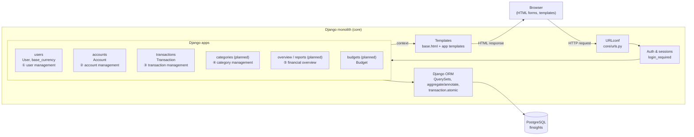

# High-level system architecture

Source: hand-drawn notes "Architectural exploration" and "FinSight MVP" (photos in this folder).

## Decisions so far
- **Monolith** — a single Django project; no separate services are needed for 20–100 users.
- **Relational database (PostgreSQL)** — financial data is strongly relational (user → accounts
  → transactions) and needs consistency (atomic transfers, constraints).
- **Server-rendered UI** — Django templates, no separate front-end app.
- **Data isolation** — every query is scoped to `request.user`.

## Diagram

## MVP modules (from the notes)
| # | Module | Responsibilities | Status |
|---|--------|------------------|--------|
| 1 | User management | register, log in/out, update profile, set currency, data isolation | partial (login/logout) |
| 2 | Account management | create, list owned, view details, update, deactivate | done (first pass) |
| 3 | Transaction management | income/expense/transfer/adjustment; list, details, filter (date, account, category, type), edit, delete/reverse. Rules: positive amounts, verify ownership, consistent currency, atomic transfer, duplicate protection | partial |
| 4 | Category management | create/edit categories, assign to transactions, filter by category | planned |
| 5 | Financial overview | total assets/liabilities, income & expenses for period, net cash flow, spending by category, month comparison | planned |
