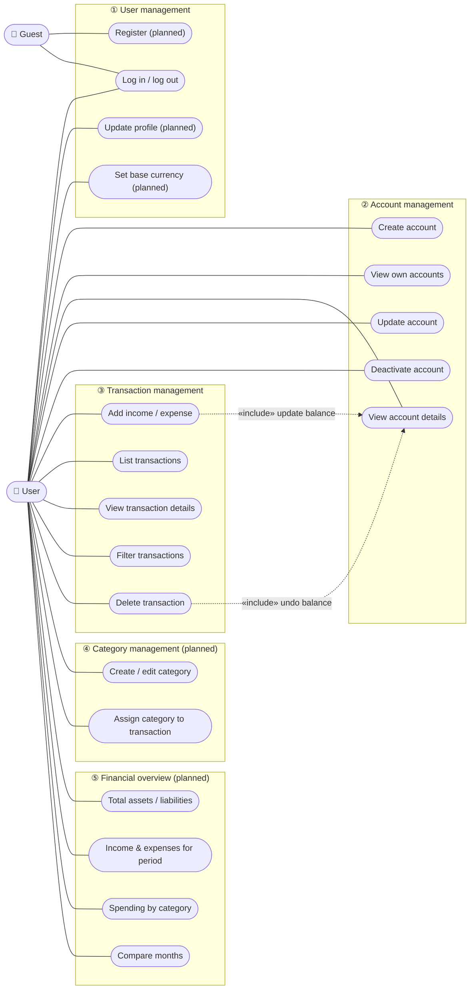

# Use-case diagram

Source: the "FinSight MVP" sketch (5 modules). Use cases marked *(planned)* are not built yet.
Mermaid has no native use-case diagram, so this one uses a flowchart: the actor on the left
and the use cases as rounded nodes grouped by module.

Note: every use case of a logged-in user is limited to **their own data** (data isolation).
